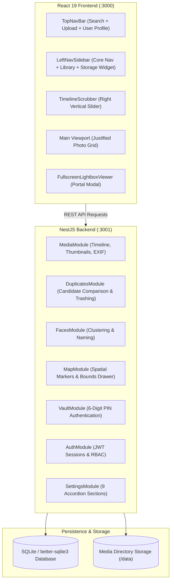
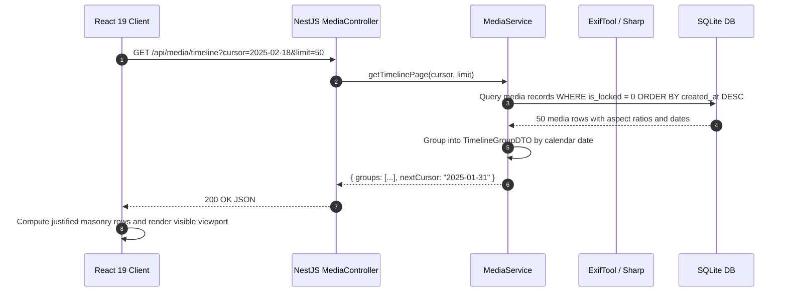
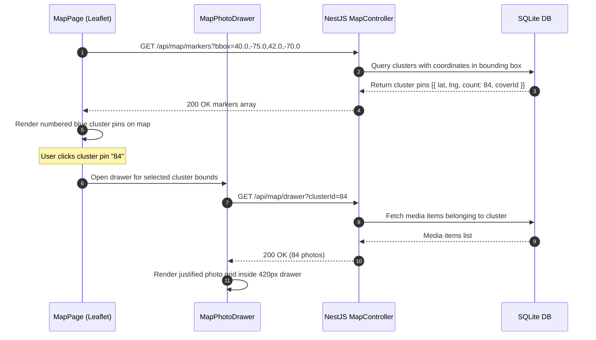
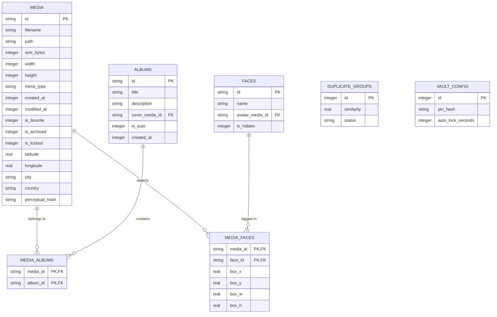

# Media Cataloger Web — Living System Architecture

## Document Metadata
- **System**: Media Cataloger Web Application & Backend (`media_cataloger_web`)
- **Version**: 2.0.0
- **Architect**: SDM System Architect (`sdm-system-architect`)
- **Status**: `Living Document — Synchronized with V2 Immich Architecture`
- **Last Updated**: 2026-10-13

---

## 1. Architectural Overview

`media_cataloger_web` is a modern, high-performance personal media management platform engineered to deliver an **Immich-style** user experience. The system is designed as a cohesive full-stack web application:

- **Client Architecture**:
  - **Framework**: React 19 with functional components and hooks.
  - **Routing**: React Router DOM v7 (`createBrowserRouter`) with route-level lazy loading and `Suspense` fallbacks.
  - **Styling**: Tailwind CSS v3 orchestrated via CSS Custom Properties (`tokens.css`) supporting reactive Light and Dark theme switching.
  - **UI Toolkit**: Radix UI primitives and Lucide React iconography (`lucide-react`).
  - **Media Grid**: TanStack React Virtual (`@tanstack/react-virtual`) driving infinite-scrolling, aspect-ratio preserved justified masonry layouts.
- **Server Architecture**:
  - **Framework**: NestJS v11 built on Express with modular domain separation.
  - **Runtime & Language**: Node.js 22 LTS, TypeScript 5.7+ running via TSX in development.
  - **Persistence**: SQLite 3 driven by `better-sqlite3` with atomic transactions, WAL mode, and structured schema migrations.
  - **Media Processing**: `sharp` for image thumbnailing, `exiftool-vendored` for metadata extraction, and `heic-convert` for modern smartphone photo formats.



---

## 2. Flow Diagrams

### 2.1. Media Ingestion & Timeline Virtualization Flow


### 2.2. Interactive Map & Slide-Over Drawer Flow


---

## 3. API Contracts

### 3.1. Media Timeline
- **Endpoint**: `GET /api/media/timeline`
- **Headers**: `Authorization: Bearer <token>`, optional `X-Vault-Token: <token>`
- **Query Parameters**:
  - `cursor` (string, optional): ISO date or item ID for pagination cursor.
  - `limit` (number, default: 50): Max items to return.
- **Success Response (`200 OK`)**:
  ```json
  {
    "groups": [
      {
        "date": "2025-02-18",
        "dateFormatted": "Tue, Feb 18, 2025",
        "items": [
          {
            "id": "med_9a8b7c",
            "filename": "mountains_binoculars.jpg",
            "thumbnailUrl": "/api/media/med_9a8b7c/thumbnail",
            "width": 1920,
            "height": 1080,
            "aspectRatio": 1.778,
            "createdAt": "2025-02-18T14:32:00Z",
            "isFavorite": false,
            "isLocked": false
          }
        ]
      }
    ],
    "nextCursor": "2025-02-15"
  }
  ```
- **Error Response (`401 Unauthorized`)**:
  ```json
  {
    "statusCode": 401,
    "message": "Authentication required",
    "error": "Unauthorized"
  }
  ```

### 3.2. Duplicate Resolution
- **Endpoint**: `POST /api/duplicates/resolve`
- **Headers**: `Authorization: Bearer <token>`, `Content-Type: application/json`
- **Request Body**:
  ```json
  {
    "clusterId": 128,
    "action": "TRASH_CANDIDATE",
    "candidateId": "aa835a7a-b4ec-4635-bebf-fc05a021a446"
  }
  ```
- **Success Response (`200 OK`)**:
  ```json
  {
    "success": true,
    "resolvedClusterId": 128,
    "remainingClustersCount": 127
  }
  ```
- **Error Response (`404 Not Found`)**:
  ```json
  {
    "statusCode": 404,
    "message": "Duplicate cluster 128 not found",
    "error": "Not Found"
  }
  ```

### 3.3. Locked Folder (Private Vault) PIN Verification
- **Endpoint**: `POST /api/vault/verify-pin`
- **Headers**: `Authorization: Bearer <token>`, `Content-Type: application/json`
- **Request Body**:
  ```json
  {
    "pin": "123456"
  }
  ```
- **Success Response (`200 OK`)**:
  ```json
  {
    "success": true,
    "vaultToken": "eyJhbGciOiJIUzI1NiIsInR5cCI6IkpXVCJ9.scoped_vault_access...",
    "expiresInSeconds": 900
  }
  ```
- **Error Response (`401 Unauthorized`)**:
  ```json
  {
    "statusCode": 401,
    "message": "Неверный PIN-код для личной папки",
    "error": "INVALID_PIN"
  }
  ```

---

## 4. Module & Function Definitions

### 4.1. `MediaService`
- **`getTimeline(cursor, limit, vaultToken)`**:
  - **Happy Path**: Queries SQLite for media records. If `vaultToken` is verified, includes `is_locked = 1` items; otherwise strictly excludes locked files. Groups rows into calendar date buckets.
  - **Failure / Fallback**: If database query times out, returns cached timeline metadata and logs structured warning via `LoggingService`.
- **`toggleFavorite(mediaId, isFavorite)`**:
  - **Happy Path**: Atomically updates `is_favorite` flag in SQLite and broadcasts cache invalidation event.
  - **Failure / Fallback**: Returns 404 if item does not exist.

### 4.2. `DuplicatesService`
- **`getDuplicateClusters(page, limit)`**:
  - **Happy Path**: Returns duplicate pairs with calculated perceptual similarity scores, auto-recommending higher resolution candidate as `KEEP` and smaller/older file as `TRASH`.
  - **Failure / Fallback**: Returns empty array if no unresolved duplicates exist.

### 4.3. `VaultService`
- **`verifyPin(pin, userId)`**:
  - **Happy Path**: Compares submitted 6-digit PIN against stored `bcrypt` hash. Generates a signed scoped JWT token valid for 15 minutes.
  - **Failure / Fallback**: Rate-limits after 5 consecutive failures with 60-second lockout.

---

## 5. Security & Authorization

1. **User Authentication**:
   - Access tokens issued as HTTP-only secure cookie or Authorization Bearer header.
   - User profile endpoints guarded by `JwtAuthGuard`.
2. **Private Vault (Locked Folder) Architecture**:
   - Isolated security domain protecting confidential photos.
   - 6-digit PIN hashed using `bcrypt` (cost factor 10).
   - Scoped `vaultToken` grants temporary access only to `/api/vault/*` and allows `is_locked` media to pass filters.
   - Automatic session expiry after 15 minutes of user inactivity.

---

## 6. Feature Toggles & Configuration

Configuration is centrally managed via `server/config/config.service.ts`:
- `ENABLE_FACE_RECOGNITION`: Enables background face detection and `/people` route. Default: `true`.
- `ENABLE_GEO_MAP`: Enables reverse geocoding and `/map` route. Default: `true`.
- `ENABLE_DUPLICATE_SCAN`: Enables perceptual hash background job. Default: `true`.
- `AUTO_LOCK_VAULT_MINUTES`: Vault timeout in minutes. Default: `15`.

---

## 7. Data Models & SQLite Schema (ERD)



---

## 8. Synchronization & Offline Strategy

- **Optimistic UI Updates**: Client immediately reflects state changes (e.g. toggling favorite heart `🤍` or selecting keep candidate) before server response, rolling back on error.
- **Thumbnail Caching**: Service Worker and browser Cache API cache media thumbnails with `Cache-Control: public, max-age=31536000, immutable`.
- **Background Scan Jobs**: Cron-based background workers periodically re-scan media folders, process EXIF metadata, and recalculate duplicate clusters without blocking the main event loop.

---

## 9. Deployment Architecture

- **Development**:
  - Client dev server: Vite running on `http://localhost:3000` with API proxy to port 3001.
  - Server dev server: NestJS running on `http://localhost:3001`.
- **Production Bundle**:
  - Client compiled to static bundle in `dist/`.
  - NestJS serves API routes under `/api/*` and serves static frontend bundle for all SPA routes (`/*`).
- **Containerization**:
  - `Dockerfile` and `docker-compose.yml` for unified deployment with volume mounts for media storage (`/data`) and SQLite database persistence.
